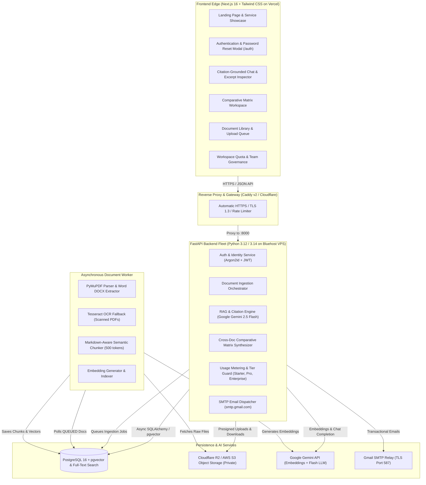
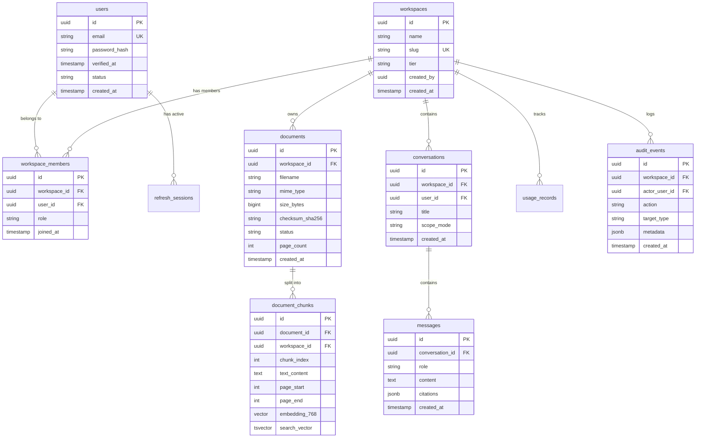

# DocMind Enterprise SaaS — Master Architecture, Features & Tech Stack Manual

> **Purpose of this Document:**  
> This document is the comprehensive, authoritative technical specification and architectural manual for **DocMind**. It is specifically structured so that any engineer, architect, or AI assistant (such as Anthropic Claude, OpenAI ChatGPT, or Google Gemini) can immediately grasp the **core vision, business goals, complete tech stack, end-to-end data pipelines, database models, and active codebase layout** to provide instant, context-aware assistance when debugging, refactoring, or extending features.

---

## 1. Executive Summary & The Core Goal

### What is DocMind?
**DocMind** is an enterprise-grade, multi-tenant **Document Intelligence & Grounded Retrieval-Augmented Generation (RAG) SaaS platform**. It allows organizations, legal teams, compliance officers, financial researchers, and enterprise workers to upload complex reference documents (PDFs, Word DOCX, text files), parse them into high-fidelity structured representations, and interact with them through an AI assistant that adheres to a **zero-hallucination, strict citation-grounded evidence policy**.

### What Was the Real Problem We Solved?
Standard AI chat tools and generic RAG frameworks suffer from critical flaws when deployed in enterprise settings:
1. **Hallucination & Fabrication**: Generative models blend external training knowledge with document facts, producing answers that "sound right" but are factually baseless.
2. **Missing Citations**: Generic tools do not indicate *where* in a 200-page regulatory filing or contract a statement came from.
3. **Table & Formatting Destruction**: Standard text extractors flatten tables into unstructured word soup, destroying financial metrics, balance sheets, and contract matrices.
4. **Lack of Multi-Document Comparison**: Analyzing 3 competing vendor agreements or regulatory updates requires tedious side-by-side human review.
5. **Multi-Tenant Data Leaks**: Weak tenant boundaries allow cross-company data leakage or unauthorized access across corporate accounts.

### What is the Ultimate Goal We Built?
We set out to build a production-grade, enterprise-compliant SaaS with:
- **Verifiable Citations**: Every claim generated by the assistant is tied to a numbered source tag (e.g. `[S1]`, `[S2]`) containing the exact document title, page number, and verbatim excerpt.
- **Cross-Document Comparative Matrix Engine**: Synthesizes side-by-side feature, clause, and liability matrices across 2 to 5 documents simultaneously.
- **Hybrid Search Engine**: Fuses 768-dimensional vector semantic search with PostgreSQL `tsvector` keyword search using Reciprocal Rank Fusion ($k=60$).
- **Multi-Tenant Hierarchy & Governance**: Strict tenant isolation at rest, during upload, and at query time, featuring hierarchical workspace roles (`OWNER`, `ADMIN`, `MEMBER`, `VIEWER`), member invitations, and quota metering.
- **Transactional Email & Security**: Production Gmail SMTP integration for account activation, single-use password resets, and branded workspace collaboration invites.
- **Low-Cost, High-Performance Infrastructure**: Deployable on a single-node VPS ($12–$24/mo) with PostgreSQL + pgvector, Caddy SSL, and a globally distributed Vercel frontend.

---

## 2. System Architecture & Component Diagram



---

## 3. Complete Tech Stack Reference

### Frontend Stack
| Component | Technology | Version / Spec | Purpose |
| :--- | :--- | :--- | :--- |
| **Framework** | Next.js (App Router) | `16.4.3` | Server-side rendering, static export (`output: export`), edge routing. |
| **Language** | TypeScript | `^5.0` | Strict type safety across all DTOs and API client methods. |
| **Styling** | Tailwind CSS + PostCSS | `v4` | High-tech dark enterprise aesthetic (`slate-950`, `cyan-400`, `teal-400`). |
| **Icons** | Heroicons / SVG / Lucide | Custom SVGs | Lightweight, zero-dependency icon components. |
| **API Client** | Native Fetch + Custom Wrapper | `ApiClient` | Auto-bearer token injection, cookie refresh, workspace ID header (`X-Workspace-ID`). |
| **Deployment** | Vercel Edge Network | Production | Global CDN, automatic previews on Git push. |

### Backend Stack
| Component | Technology | Version / Spec | Purpose |
| :--- | :--- | :--- | :--- |
| **Framework** | FastAPI | `0.110+` | High-throughput asynchronous REST API with OpenAPI/Swagger docs. |
| **Language** | Python | `3.12+` / `3.14` | Modern asynchronous Python (`async`/`await`). |
| **ORM & DB Layer** | SQLAlchemy 2.0 (Async) | `asyncpg` | Async connection pooling, typed mapped columns, statement compilation. |
| **Password Hashing**| Argon2id via `argon2-cffi` | `time_cost=2, memory=64MB` | Memory-hard, state-of-the-art password encryption. |
| **Tokens & Sessions**| PyJWT | `HS256` | 15-min access tokens, single-use reset tokens, 30-day rotating refresh tokens. |
| **Validation** | Pydantic v2 | `BaseModel`, `Field` | Request body validation, RFC 7807 problem details error handling. |

### AI, Retrieval & Vector Search
| Component | Technology | Specification | Details |
| :--- | :--- | :--- | :--- |
| **LLM Provider** | Google Gemini | `gemini-2.5-flash` | High context window, structured JSON mode, ultra-fast latency. |
| **Embedding Model**| Google Gemini | `gemini-embedding-2` / `text-embedding-004` | 768-dimensional normalized dense vectors. |
| **Vector DB** | PostgreSQL + `pgvector` | `0.2.5+` | Native Cosine distance (`<=>`) with IVFFlat / HNSW indexes. |
| **Lexical Search** | PostgreSQL FTS | `to_tsvector('english', ...)` | Full-Text Search with GIN index on document chunks. |
| **Reranking** | Reciprocal Rank Fusion | RRF with $k=60$ | Merges vector semantic rank with full-text keyword rank. |

### File Ingestion & Parsing
| Component | Technology | Role |
| :--- | :--- | :--- |
| **PDF Extraction** | PyMuPDF (`pymupdf`) | Fast native page text extraction, vector bbox coordinates, font detection. |
| **OCR Fallback** | Tesseract OCR (`tesseract-ocr`) | Automatic fallback when page text yield is below threshold (scanned PDFs). |
| **DOCX Extraction** | `python-docx` | Word document paragraph hierarchy, bullet parsing, and table reconstruction. |
| **Table Parsing** | Custom Table Normalizer | Converts document tables into standard Markdown pipe syntax (`\| Col \|`). |
| **Chunking** | Markdown-Aware Semantic Chunker | 500-token sliding window, 10% overlap, preserves heading hierarchy. |

### Storage, Email & Infrastructure
| Component | Technology | Role |
| :--- | :--- | :--- |
| **Object Storage** | Cloudflare R2 / AWS S3 API | Direct browser-to-bucket presigned PUT uploads, private SHA-256 storage. |
| **Transactional Email**| Gmail SMTP over TLS | Port `587`, TLS encryption, responsive HTML templates for verification & reset. |
| **Web Server / SSL** | Caddy v2 | Auto Let's Encrypt SSL/TLS certificates, reverse proxy to `:8000`. |
| **Orchestration** | Docker & Docker Compose | Multi-container stack (`caddy`, `api`, `worker`, `postgres`). |

---

## 4. In-Depth Feature Breakdown

### 1. Modern Animated Landing Page & Service Showcase
- **Hero & Interactive Query Playground**: Real-time simulated query interface showcasing citation chips (`[S1]`, `[S2]`) and instant excerpt inspection.
- **Enterprise Service Showcase**: Demonstrates Document Ingestion, Hybrid Search, Grounded RAG, Comparative Analysis, and Compliance Guardrails.
- **SaaS Pricing Grid**: Live toggle between Starter ($0/mo), Pro ($79/mo), and Enterprise ($299/mo) with tier feature breakdowns.
- **Security & Compliance Credentials**: Showcases AES-256 at rest, TLS 1.3 in transit, tenant isolation, and strict retention policies.

### 2. Multi-Tenant Identity, Workspaces & Governance (FR-001 – FR-010)
- **Tenant Hierarchy**: Every user can belong to multiple workspaces (`Personal Workspace` created automatically on signup, or `Company Workspace`).
- **Granular RBAC**:
  - `OWNER`: Full administrative power, billing, workspace deletion, tier upgrades.
  - `ADMIN`: Manage members, upload/delete documents, view audit logs.
  - `MEMBER`: Upload documents, create conversations, query AI, run comparisons.
  - `VIEWER`: Read-only access to documents, citations, and conversation history.
- **Cross-Tenant Guardrail**: Every database query for documents, chunks, and messages enforces `WHERE workspace_id = :authenticated_workspace_id`. Cross-tenant URL tampering immediately triggers an RFC 7807 `403 Forbidden` (`CrossTenantAccessException`).

### 3. Asynchronous Ingestion & OCR Pipeline (FR-011 – FR-024)
- **State Machine**: Documents transition through deterministic states:
  $$\text{UPLOADING} \longrightarrow \text{QUEUED} \longrightarrow \text{PROCESSING} \longrightarrow \text{READY} \quad (\text{or } \text{FAILED})$$
- **Presigned Direct Upload**: Client requests upload intent (`POST /documents/upload-intent`), receives a presigned PUT URL directly to private object storage (R2/S3), and confirms completion via checksum verification (`POST /documents/{id}/confirm-upload`).
- **OCR Engine**: When PyMuPDF detects that a PDF contains scanned images with under 50 characters of selectable text per page, it automatically triggers Tesseract OCR on rendered page pixmaps.
- **Table Preservation**: Multi-column tables from PDFs and Word documents are parsed into structured Markdown tables so the embedding model and LLM preserve relational data.

### 4. Hybrid Retrieval & Ground-Truth RAG Chat (FR-025 – FR-034)
- **Reciprocal Rank Fusion (RRF)**:
  Queries perform both vector similarity search (dense cosine distance) and PostgreSQL full-text search (sparse lexical search). Scores are combined using:
  $$RRF\_Score(d) = \frac{1}{60 + Rank_{vector}(d)} + \frac{1}{60 + Rank_{fts}(d)}$$
- **Strict Evidence Bounding**: The system prompt injects retrieved chunks inside explicit XML tags `<retrieved_context>` and enforces that the LLM must *never* invent facts outside the text. If the evidence is insufficient, it replies:
  *"I cannot find sufficient evidence in the uploaded documents to answer this question."*
- **Verifiable Citation Format**: Answers format citations as inline tags (e.g. `[S1]`, `[S2]`). The API maps these tags into structured `CitationDTO` objects containing:
  - `citation_id`: e.g. `"S1"`
  - `document_id`: UUID of the source document
  - `filename`: Original file name
  - `page_start` & `page_end`: Exact page range
  - `excerpt`: The exact passage supporting the statement
- **Interactive Citation Drawer**: Clicking any citation badge in the frontend opens a slide-over drawer highlighting the verbatim excerpt and document metadata.

### 5. Cross-Document Comparative Matrix Engine (FR-031 – FR-033)
- **Multi-Document Synthesis**: Users select between 2 and 5 documents (e.g., competing vendor contracts, annual audit reports, or specification drafts).
- **Difference Matrix**: The engine runs hybrid retrieval across all selected documents simultaneously for a focus topic (e.g., *“Limitation of Liability & Indemnification”* or *“SLA & Uptime Guarantees”*) and prompts Gemini to output:
  1. A structured Markdown comparison table (columns = documents, rows = key criteria).
  2. A bulleted synthesis of critical differences and edge cases.
  3. Actionable recommendations and risk flags.
- **Copy-to-Clipboard**: One-click export of the comparison matrix into clean Markdown for executive reports and Jira/Confluence tickets.

### 6. Quota Metering & SaaS Tier Enforcement (FR-040 – FR-044)
Dynamic limits enforced per workspace tier:
| Quota Metric | Starter (Solo Researcher) | Pro (Team / Company) | Enterprise (Organization) |
| :--- | :--- | :--- | :--- |
| **Max Documents** | 20 docs | 500 docs | 5,000 docs |
| **Max Storage** | 200 MB | 10 GB | 100 GB |
| **Monthly Questions**| 100 questions | 2,500 questions | 25,000 questions |
| **Max File Size** | 20 MB / file | 50 MB / file | 100 MB / file |
| **Max Pages** | 200 pages / file | 500 pages / file | 2,000 pages / file |
| **Concurrent Uploads**| 1 concurrent | 5 concurrent | 20 concurrent |
| **Team Member Seats**| 1 seat | 25 seats | 500 seats |

- **Usage Metering**: Tracks consumption in `usage_records` (resetting on billing cycle rollover). Quota breaches return an RFC 7807 `429 Too Many Requests` or `402 Payment Required` with upgrade instructions.
- **Immutable Audit Trail**: All governance actions (`WORKSPACE_CREATED`, `MEMBER_INVITED`, `DOCUMENT_UPLOADED`, `DOCUMENT_DELETED`, `TIER_UPGRADED`) are logged to `audit_events`.

### 7. Production Transactional Email & Security (FR-001 – FR-005)
- **Gmail SMTP Integration**: Connected via `smtp.gmail.com:587` with TLS encryption (`docmindofficial@gmail.com`).
- **Branded Enterprise HTML Templates**: Custom responsive templates for:
  - Account email verification with 24-hour expiration token.
  - Single-use password reset link with 60-minute expiration token.
  - Team collaboration invitation links.
- **Cryptographic Single-Use Reset Tokens**: Reset tokens embed a SHA-256 fingerprint of the user's current password hash (`payload["pwhash"] = sha256(current_hash)[:24]`). As soon as the password is reset, the user's hash changes, instantly rendering the token invalid with zero extra database lookups!
- **Anti-Enumeration Protection**: The `/auth/forgot-password` endpoint always responds with `202 Accepted` regardless of whether the email address exists in the database.

---

## 5. Database Schema & Entity Relationships



---

## 6. Codebase File Map & Directory Layout

```
DocMind/
├── .env                              # Production secrets & API keys (gitignored)
├── .env.example                      # Template environment variables
├── pyproject.toml                    # Pytest configuration
├── pyrightconfig.json                # Strict Pyright type checking configuration
├── DocMind_PRD_Technical_Specification_v1.0.pdf  # Authoritative PRD
│
├── backend/                          # FastAPI Backend Application
│   ├── Dockerfile                    # Python 3.12 slim container with Tesseract OCR
│   ├── requirements.txt              # Production Python dependencies
│   ├── app/
│   │   ├── main.py                   # FastAPI entrypoint, CORS & error handlers
│   │   ├── adapters/
│   │   │   ├── email/                # SMTP delivery & branded HTML email templates
│   │   │   │   ├── base.py           # EmailProvider Protocol definition
│   │   │   │   └── smtp.py           # SMTPEmailProvider with Gmail TLS
│   │   │   └── storage/              # S3/R2 object storage adapters
│   │   ├── api/v1/                   # REST API routes
│   │   │   ├── auth.py               # Register, Login, Demo Login, Verify, Forgot, Reset
│   │   │   ├── chat.py               # Grounded RAG chat conversations & streaming
│   │   │   ├── compare.py            # Cross-document comparative matrix synthesis
│   │   │   ├── documents.py          # Upload intent, confirm, list, delete, retry
│   │   │   ├── workspaces.py         # Multi-tenant workspaces, members, invites, audit logs
│   │   │   ├── usage.py              # Usage summary, quota status, tier specs
│   │   │   └── dependencies.py       # JWT session auth & tenant resolver
│   │   ├── core/
│   │   │   ├── config.py             # Pydantic BaseSettings loading .env
│   │   │   ├── security.py           # Argon2id, JWT, tokens with SHA-256 fingerprinting
│   │   │   └── exceptions.py         # RFC 7807 problem details error classes
│   │   ├── models/
│   │   │   ├── entities.py           # SQLAlchemy declarative ORM models
│   │   │   └── enums.py              # Enums: DocumentStatus, WorkspaceTier, WorkspaceRole
│   │   ├── repositories/             # Database access layer
│   │   │   ├── user.py               # User queries, verification, password updates
│   │   │   ├── workspace.py          # Workspace CRUD, membership joins, role checks
│   │   │   ├── document.py           # Document metadata, status transitions
│   │   │   ├── chunk.py              # Vector similarity <=> & FTS RRF queries
│   │   │   └── audit.py              # Audit logging repository
│   │   ├── services/                 # Domain business logic
│   │   │   ├── auth.py               # Authentication service & token issuance
│   │   │   ├── ai_chat.py            # Gemini RAG prompting & citation tag parsing
│   │   │   ├── ai_intelligence.py    # Multi-doc comparison & structured extraction
│   │   │   └── quota.py              # Tier validation & consumption checks
│   │   └── workers/
│   │       ├── runner.py             # Polling worker daemon
│   │       ├── parser/               # PyMuPDF, docx, and table parsing
│   │       ├── ocr.py                # Tesseract OCR engine for scanned PDFs
│   │       └── chunker.py            # Markdown-aware sliding window chunker
│   └── tests/                        # Pytest suite
│       ├── unit/                     # Unit tests for chunker, parsers, compare, quotas, email auth
│       └── security/                 # Tenant isolation & cross-tenant tampering tests
│
├── frontend/                         # Next.js 16 Web Application
│   ├── app/
│   │   ├── layout.tsx                # Root layout with fonts and metadata
│   │   ├── page.tsx                  # Master application container (Landing Page + App Tabs)
│   │   └── auth/page.tsx             # Dedicated action handler for email verify, reset & invite
│   ├── components/
│   │   ├── LandingPage.tsx           # Modern animated marketing showcase & demo
│   │   ├── Navbar.tsx                # Enterprise top bar with workspace switcher
│   │   ├── Sidebar.tsx               # Navigation tabs (Dashboard, Library, Chat, Compare, Settings)
│   │   ├── AuthModal.tsx             # Sign in, Sign up, and Forgot password modal
│   │   ├── CitationDrawer.tsx        # Slide-over evidence viewer with verbatim excerpts
│   │   └── UploadModal.tsx           # Drag-and-drop file upload dialog
│   └── lib/
│       └── api.ts                    # Strongly-typed API client wrapper
│
└── infra/                            # Production Deployment Infrastructure
    ├── compose.yaml                  # Multi-container Docker Compose (Caddy, API, Worker, Postgres)
    ├── Caddyfile                     # Caddy reverse proxy with automatic SSL/TLS
    ├── postgres/init.sql             # Postgres init script enabling pgvector extension
    └── scripts/
        ├── deploy.sh                 # Zero-downtime deployment & readiness check script
        └── backup.sh                 # Encrypted database snapshot & rotation script
```

---

## 7. Key API Endpoints Reference

| HTTP Method | Route | Description | Auth Required |
| :--- | :--- | :--- | :---: |
| `POST` | `/api/v1/auth/register` | Create account + auto-create personal workspace | No |
| `POST` | `/api/v1/auth/login` | Authenticate user, set HttpOnly refresh cookie | No |
| `POST` | `/api/v1/auth/demo-login` | Instant demo sandbox session | No |
| `POST` | `/api/v1/auth/verify-email` | Validate 24h verification token and activate account | No |
| `POST` | `/api/v1/auth/forgot-password` | Dispatches single-use password reset link via SMTP | No |
| `POST` | `/api/v1/auth/reset-password` | Resets password with single-use token & revokes sessions | No |
| `GET` | `/api/v1/workspaces` | List all workspaces user has access to | Yes |
| `POST` | `/api/v1/workspaces/company` | Create a company workspace (with custom slug) | Yes |
| `POST` | `/api/v1/workspaces/{id}/invites` | Invite team member by email & dispatch branded email | Yes (Admin/Owner) |
| `PATCH`| `/api/v1/workspaces/{id}/tier` | Change workspace tier (`STARTER`, `PRO`, `ENTERPRISE`) | Yes (Owner) |
| `GET` | `/api/v1/workspaces/{id}/audit-logs` | Retrieve immutable audit event logs | Yes (Admin/Owner) |
| `POST` | `/api/v1/documents/upload-intent` | Request presigned PUT URL and check storage quotas | Yes |
| `POST` | `/api/v1/documents/{id}/confirm-upload` | Validate SHA-256 and queue document for ingestion | Yes |
| `GET` | `/api/v1/documents` | List documents in active workspace with status | Yes |
| `POST` | `/api/v1/conversations` | Create conversation scoped to all or selected docs | Yes |
| `POST` | `/api/v1/conversations/{id}/messages` | Grounded RAG chat with strict citation tags `[S1]` | Yes |
| `POST` | `/api/v1/documents/compare` | Synthesize cross-document comparative matrix (2–5 docs)| Yes |
| `GET` | `/health/ready` | Health check probe (verifies DB & object storage) | No |

---

## 8. Deployment & Hosting Strategy

### 1. Hybrid Vercel + Bluehost VPS Architecture
- **Frontend on Vercel**:
  - Global edge CDN distribution.
  - Automatically builds from `frontend/` directory with `output: export`.
  - Configured with `NEXT_PUBLIC_API_BASE_URL=https://api.yourdomain.com/api/v1` (or `http://<VPS_IP>:8000/api/v1`).
- **Backend on Bluehost VPS**:
  - Single-node Ubuntu 22.04 / 24.04 VPS with root SSH access.
  - Docker Compose orchestrates:
    - `api`: FastAPI running Uvicorn with 2 workers.
    - `worker`: Asynchronous Python daemon handling OCR, parsing, and chunk embedding.
    - `postgres`: PostgreSQL 16 with `pgvector` extension enabled.
    - `caddy`: Reverse proxy provisioning free SSL certificates via Let's Encrypt.
- **Port Layout**:
  - Port `80` & `443`: Handled by Caddy.
  - Port `8000`: FastAPI API container (exposed to host for direct testing).
  - Port `5432`: PostgreSQL (internal Docker network `docmind-net`).

---

## 9. Guidelines for AI Assistants Assisting on DocMind

When you (Claude, ChatGPT, or another AI) are asked to assist the developer with DocMind, adhere strictly to these principles:

1. **Preserve Documentation & Spec Integrity**:
   - Always refer to the PRD specifications (`DocMind_PRD_Technical_Specification_v1.0.pdf`).
   - Do not remove or alter existing business logic, citation grounding rules, or docstrings unless explicitly instructed.
2. **Type Checking & Code Quality**:
   - The backend runs **Pyright** in strict mode: `npx pyright backend/`. Always keep errors and warnings at **0**.
   - The test suite is executed using `PYTHONPATH=backend venv/bin/pytest`. All 23+ unit and security tests must pass.
3. **Single-Use Token Security**:
   - Password reset tokens must always embed the SHA-256 fingerprint of the current password hash so that used or superseded tokens cannot be replayed.
4. **Tenant Isolation**:
   - Never resolve `workspace_id` from unauthenticated client input. Always derive `workspace_id` from the verified JWT payload or validated membership record.
5. **No Hallucinations in RAG**:
   - Never remove or weaken the `<retrieved_context>` XML bounding or citation extraction pipeline. If the model has insufficient evidence, it must declare so plainly.
6. **Frontend Static Compatibility**:
   - Next.js is configured with `output: "export"`. Any dynamic hooks using `useSearchParams()` must be wrapped inside a `<React.Suspense>` boundary to prevent build failures.

